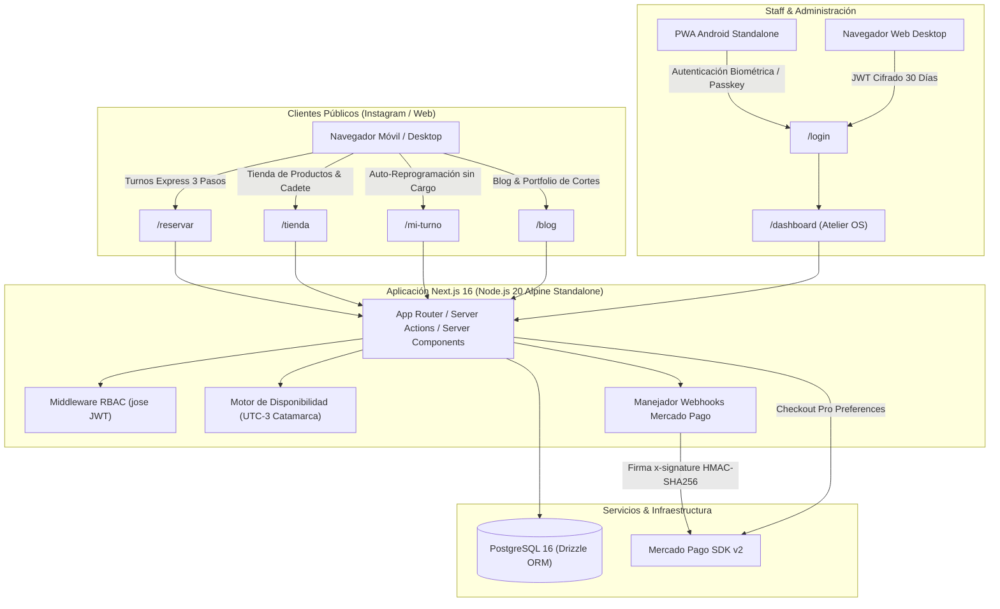
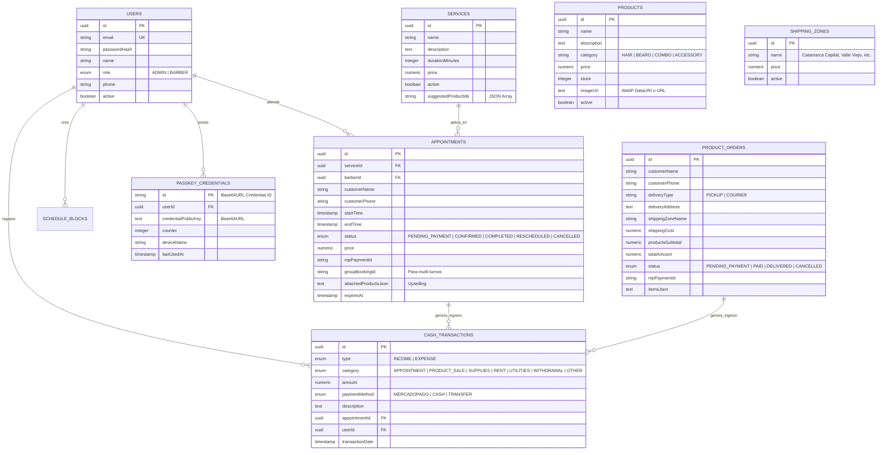
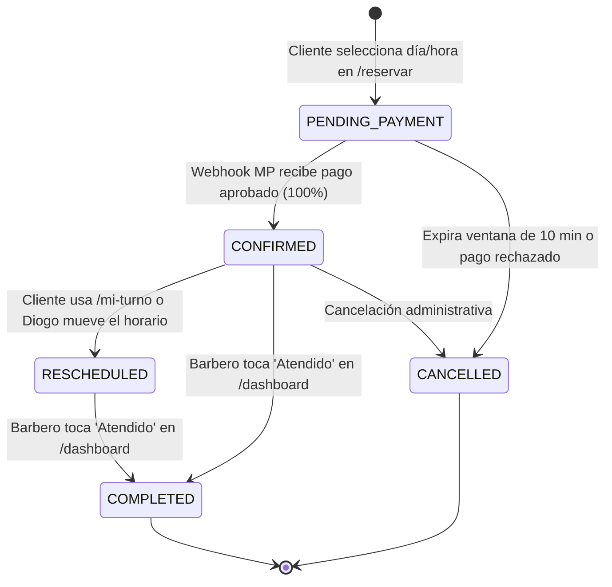
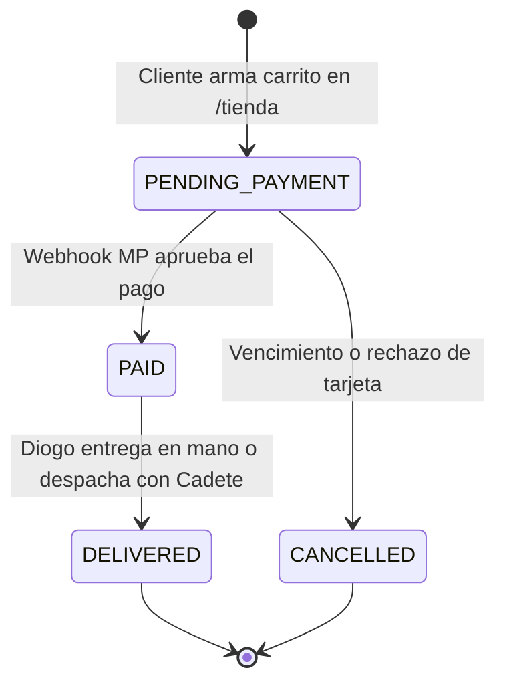

# 🏛️ Documentación Técnica & Arquitectura de Software
### *Sistema Web Integral Diogo Barber Shop (@diogobarbershopp)*
**Versión de la Plataforma:** v0.4.1  
**Entorno de Producción:** VPS Hetzner Cloud administrado vía Coolify v4 + Docker Standalone  
**Base de Datos:** PostgreSQL 16 Nativo  
**Última Actualización:** Octubre 2026  

---

## 1. Visión General de la Arquitectura

---

## 2. Registro de Decisiones de Arquitectura (ADRs)

### ADR-001: Next.js 16 App Router con Turbopack y Salida Standalone
- **Estado:** Aceptado
- **Contexto:** Se requiere una arquitectura monolítica moderna, modular y eficiente, optimizada para desplegarse dentro de contenedores Docker en un VPS Hetzner gestionado con Coolify v4.
- **Decisión:** Implementar Next.js 16 con App Router, React 19 nativo, TypeScript 5 en modo estricto (`strict: true`) y compilación `output: 'standalone'` en `next.config.ts`.
- **Consecuencias:**
  - Las consultas directas a base de datos se realizan en **Server Components** eliminando llamadas API innecesarias y fugas de tokens en el cliente.
  - Las mutaciones de estado se gestionan mediante **Server Actions** fuertemente tipadas.
  - La imagen Docker final multi-stage (`node:20-alpine`) pesa menos de 180 MB, garantizando consumos mínimos de memoria RAM (< 120 MB en reposo).

---

### ADR-002: Auto-Migración Idempotente de Base de Datos (`ensureExtendedSchema`)
- **Estado:** Aceptado
- **Contexto:** Al desplegar en contenedores efímeros mediante Coolify, no siempre se dispone de acceso a terminal interactiva para ejecutar `drizzle-kit push` o migraciones manuales sin interrumpir el servicio.
- **Decisión:** Crear un módulo centralizado [`src/db/ensureSchema.ts`](file:///c:/Users/Ulises/Documents/PROYECTOS/Diogo-Barber-Shop/src/db/ensureSchema.ts) que ejecuta sentencias SQL `CREATE TABLE IF NOT EXISTS`, `ALTER TABLE ... ADD COLUMN IF NOT EXISTS` e inserts condicionales (`ON CONFLICT DO NOTHING`) de manera idempotente al iniciar cualquier Server Action o consulta crítica.
- **Consecuencias:**
  - Nuevas tablas (`products`, `shipping_zones`, `product_orders`, `blog_posts`, `passkey_credentials`) se inicializan de forma transparente sin tocar tablas existentes ni perder datos de producción.
  - Cero tiempo de inactividad (zero-downtime) ante nuevos despliegues de versión.

---

### ADR-003: Autenticación Propietaria RBAC + WebAuthn FIDO2 Passkeys
- **Estado:** Aceptado
- **Contexto:** Evitar dependencias de servicios de autenticación de pago o externos (Auth0, Clerk, Firebase) y proporcionar acceso biométrico nativo (huella/Face ID) para el dueño en su celular Android con sesión persistente.
- **Decisión:**
  - Sistema de tokens JWT seguros usando `jose` con algoritmos `HS256`, emisor (`diogo-barber-shop`), audiencia (`diogo-barber-staff`) y cookies HttpOnly con `SameSite=Lax` y `maxAge` extendido a 30 días.
  - Integración nativa de **WebAuthn Passkeys** con `@simplewebauthn/server` en el backend y `webauthn-polyfills` con APIs nativas del navegador en el frontend (sin librerías pesadas en cliente), cumpliendo las guías `passkeys`, `passkey-registration` y `passkey-authentication` de `modern-web-guidance`.
- **Consecuencias:**
  - Diogo puede instalar la PWA en Android, registrar su huella en 1 toque y autenticarse en 1 segundo sin tipear contraseñas.
  - Rate limiting estricto con mitigación de ataques de tiempo (Timing Attacks) en login tradicional con contraseña.

---

### ADR-004: Cobro 100% Anticipado con Mercado Pago Checkout Pro y Bloqueo Anti-Colisión
- **Estado:** Aceptado
- **Contexto:** La barbería sufría ausentismo de turnos solicitados por chat informal y colisiones de horarios entre clientes concurrentes.
- **Decisión:**
  - Regla mandataria: Ningún turno online se confirma sin el pago del 100% del valor del servicio.
  - Bloqueo temporal: Al presionar "Pagar y Confirmar", el turno se inserta en estado `PENDING_PAYMENT` con `expiresAt = NOW() + 10 minutos`. Durante esa ventana, el motor de disponibilidad excluye esos bloques horarios para otros usuarios.
  - Webhook seguro (`/api/webhooks/mercadopago/route.ts`): Verifica criptográficamente la firma `x-signature` (HMAC-SHA256). Si el pago es `approved`, actualiza a `CONFIRMED`, limpia `expiresAt` e inserta automáticamente el movimiento de ingreso en `cash_transactions`. Si expira o es rechazado, el turno se cancela y el horario queda libre.
- **Consecuencias:** Cero ausentismo de turnos online y prevención total de race conditions.

---

### ADR-005: Integridad Contable en Envíos por Cadete
- **Estado:** Aceptado
- **Contexto:** En la tienda online (`/tienda`), los clientes pueden comprar productos con retiro en el local ($0) o con envío a domicilio por cadete en Catamarca Capital y alrededores. La tarifa del cadete se cobra en Mercado Pago junto al producto, pero no debe inflar la facturación de la barbería.
- **Decisión:**
  - Mercado Pago cobra el total (`Subtotal Productos + Costo Cadete`).
  - Al acreditarse la orden, el webhook inserta en `cash_transactions` (`PRODUCT_SALE`) **únicamente el subtotal correspondiente a los productos**.
  - El costo del cadete queda registrado en el registro de la orden (`product_orders.shipping_cost`) para su liquidación independiente al repartidor sin adulterar las métricas de ingresos ni el balance de caja de Diogo.
- **Consecuencias:** Transparencia contable absoluta y métricas de rentabilidad fidedignas.

---

### ADR-006: Tratamiento Estricto de Zona Horaria UTC-3 (Catamarca / Argentina)
- **Estado:** Aceptado
- **Contexto:** El uso estándar de `toISOString().split('T')[0]` provocaba que a partir de las 21:00 hs de Catamarca (00:00 UTC), la fecha se adelantara un día en el selector de turnos.
- **Decisión:**
  - Crear helpers dedicados [`src/utils/dateHelpers.ts`](file:///c:/Users/Ulises/Documents/PROYECTOS/Diogo-Barber-Shop/src/utils/dateHelpers.ts) utilizando `en-CA` formateado bajo `timeZone: 'America/Argentina/Catamarca'`.
  - Proyección de días abiertos/cerrados evaluada en tiempo local de Argentina.
- **Consecuencias:** Eliminación definitiva de saltos de fecha y bloqueo certero de días no laborables (ej. Domingos).

---

## 3. Modelo de Datos Entidad-Relación (Drizzle ORM)

---

## 4. Máquinas de Estados del Negocio

### Ciclo de Vida del Turno (`appointments.status`)

### Ciclo de Vida de Pedidos de Tienda (`product_orders.status`)

---

## 5. Endpoints y Server Actions del Sistema

| Módulo | Archivo / Endpoint | Función Principal |
| :--- | :--- | :--- |
| **Reservas** | [`bookingActions.ts`](file:///c:/Users/Ulises/Documents/PROYECTOS/Diogo-Barber-Shop/src/app/actions/bookingActions.ts) | Cálculo de huecos libres, reserva multi-turno con upselling y Checkout Pro |
| **Reprogramación** | [`clientRescheduleActions.ts`](file:///c:/Users/Ulises/Documents/PROYECTOS/Diogo-Barber-Shop/src/app/actions/clientRescheduleActions.ts) | Búsqueda por WhatsApp y auto-cambio de horario según ventana mínima |
| **Inventario & Tienda** | [`productActions.ts`](file:///c:/Users/Ulises/Documents/PROYECTOS/Diogo-Barber-Shop/src/app/actions/productActions.ts) | CRUD con WebP, Checkout tienda, venta presencial y zonas de cadete |
| **Servicios** | [`servicesActions.ts`](file:///c:/Users/Ulises/Documents/PROYECTOS/Diogo-Barber-Shop/src/app/actions/servicesActions.ts) | ABM de carta de cortes y asociación de productos sugeridos |
| **Blog & Portfolio** | [`blogActions.ts`](file:///c:/Users/Ulises/Documents/PROYECTOS/Diogo-Barber-Shop/src/app/actions/blogActions.ts) | Publicación de trabajos, técnicas y productos utilizados |
| **Webhooks** | `/api/webhooks/mercadopago` | Validación HMAC-SHA256, confirmación de turnos, stock y caja |
| **Biometría (Passkeys)** | `/api/auth/passkey/*` | Opciones y verificación WebAuthn FIDO2 para registro y login |

---

## 6. Despliegue en Hetzner Cloud con Coolify v4

- **Proxy Inverso:** Traefik gestionado por Coolify con certificados SSL automáticos de Let's Encrypt / Cloudflare.
- **Variables de Entorno Mandatorias:**
  - `DATABASE_URL`: Conexión de producción a PostgreSQL 16.
  - `JWT_SECRET`: Llave criptográfica de alta entropía (mínimo 32 caracteres).
  - `MERCADOPAGO_ACCESS_TOKEN`: Token de producción de Mercado Pago.
  - `MERCADOPAGO_WEBHOOK_SECRET`: Firma criptográfica para verificación de notificaciones.
  - `NEXT_PUBLIC_APP_URL`: Dominio oficial de la barbería (`https://...`).
  - `NEXT_PUBLIC_BUSINESS_PHONE`: Teléfono oficial para links de WhatsApp (`549383...`).
- **Comando de Build Docker:** Standalone runner exponiendo el puerto 3000 sin dependencias de desarrollo.
