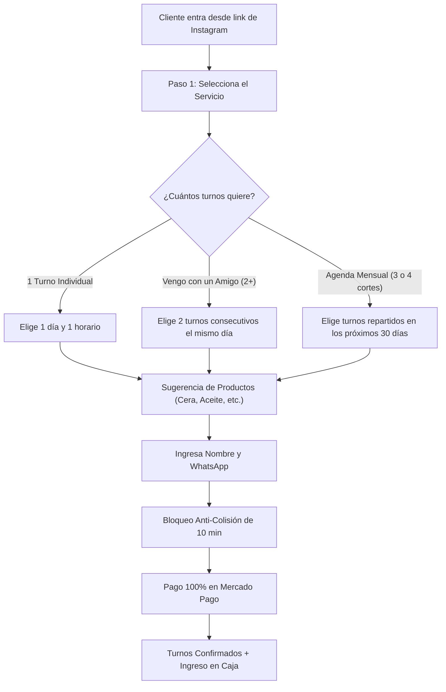

# 💈 Manual de Usuario Oficial — Diogo Barber Shop
### *Atelier OS: Plataforma Integral de Reservas, Tienda, Agenda y Finanzas*
**Versión del Sistema:** v0.4.1  
**Destinatario:** Diogo & Equipo de Barberos  
**Fecha:** Octubre 2026  

---

## 📖 Tabla de Contenidos
1. [Introducción & Filosofía del Negocio](#1-introducción--filosofía-del-negocio)
2. [Instalación en Celular Android & Acceso con Huella Digital](#2-instalación-en-celular-android--acceso-con-huella-digital)
3. [Agenda de Turnos en Vivo & Operatoria Diaria](#3-agenda-de-turnos-en-vivo--operatoria-diaria)
4. [Auto-Reprogramación de Clientes (Sin Fricción)](#4-auto-reprogramación-de-clientes-sin-fricción)
5. [Nueva Reserva Online (Multi-Turnos, Amigos & Packs)](#5-nueva-reserva-online-multi-turnos-amigos--packs)
6. [Catálogo de Servicios & Sugerencia Inteligente de Productos](#6-catálogo-de-servicios--sugerencia-inteligente-de-productos)
7. [Horarios de Atención, Franco & Feriados](#7-horarios-de-atención-franco--feriados)
8. [Inventario, Stock & Tienda Online con Cadete](#8-inventario-stock--tienda-online-con-cadete)
9. [Caja, Finanzas & Cierre en PDF](#9-caja-finanzas--cierre-en-pdf)
10. [Blog & Portfolio de Trabajos](#10-blog--portfolio-de-trabajos)
11. [Preguntas Frecuentes & Consejos Prácticos](#11-preguntas-frecuentes--consejos-prácticos)

---

## 1. Introducción & Filosofía del Negocio

Bienvenido a tu nueva plataforma web a medida. Este sistema fue diseñado específicamente para eliminar los problemas clásicos de la barbería tradicional:
- ❌ **Se acabaron los clientes que reservan por mensaje y no van:** Todo turno reservado por la web pública exige el pago del 100% anticipado por Mercado Pago. Si no pagan en 10 minutos, el horario se libera solo.
- ❌ **Se acabaron las respuestas demoradas en WhatsApp mientras estás cortando:** El cliente ve tus horarios libres en tiempo real, reserva, paga y se agenda solo.
- ❌ **Se acabó la pérdida de control del dinero y productos:** Cada peso que entra (Mercado Pago, Efectivo o Transferencia) y cada gasto que sale queda registrado con balance y exportación a PDF.

---

## 2. Instalación en Celular Android & Acceso con Huella Digital

Tu sistema está preparado para funcionar como una **aplicación nativa de Android** en tu celular, sin necesidad de abrir Chrome todos los días ni volver a escribir tu usuario y contraseña.

### Paso 1: Instalar la aplicación en tu celular
1. Desde tu celular Android, abrí el enlace de tu sistema en Google Chrome.
2. Al ingresar al panel, vas a ver un cartel en la parte inferior que dice:
   > **"Instalar App en tu Celular"** — *Accedé a Diogo Barber Shop directo desde tu pantalla de inicio.*
3. Tocá el botón dorado **"Instalar"** (o en el menú de Chrome tocá los tres puntos `⋮` y elegí *"Instalar aplicación"* / *"Agregar a pantalla principal"*).
4. En segundos tendrás el ícono oficial de **Diogo Barber** en la pantalla de inicio de tu celular, abriéndose en pantalla completa como cualquier app descargada de Play Store.

### Paso 2: Vincular tu Huella Digital (Biometría)
Para que puedas entrar apoyando tu dedo en el sensor:
1. Abrí la app e iniciá sesión con tu correo y contraseña.
2. En el menú lateral, andá a **`07 // Equipo & Accesos`**.
3. Arriba verás la tarjeta dorada: **"Acceso Biométrico Rápido (Android / Huella / Face ID)"**.
4. Tocá el botón **"Vincular Huella de este Celular"**.
5. Tu celular te pedirá apoyar el dedo en el lector de huellas o mirar la cámara. ¡Listo! Queda vinculado de por vida.

### Paso 3: Cómo entrar al día siguiente
- La sesión en tu celular dura **30 días consecutivos** sin cerrarse.
- Si por alguna razón cerraste sesión, en la pantalla de login simplemente tocás el botón:  
  **`⚡ Ingresar con Huella / Face ID`**  
  Apoyás el dedo y entrás directamente al panel sin teclear nada.

---

## 3. Agenda de Turnos en Vivo & Operatoria Diaria

La pantalla principal al abrir la aplicación es tu **Agenda de Turnos** (`/dashboard`).

### ¿Qué ves en pantalla?
- **Selector de Días:** Podés tocar los días de la semana (o usar los botones `<` y `>`) para ver turnos de hoy, mañana o cualquier fecha del mes.
- **Tarjetas KPI Superiores:**
  - **Citas Activas:** Cantidad total de turnos tomados para el día elegido.
  - **Por Atender:** Clientes que están por venir.
  - **Completados:** Clientes a los que ya les cortaste hoy.
  - **Caja de Agenda:** Total recaudado exclusivamente por los turnos del día.

### Acciones sobre un Turno:
1. **Marcar como Atendido:** Cuando el cliente termina su corte, tocás el botón verde **"✓ Atendido"**. El turno cambia de estado y se actualizan tus métricas.
2. **Mover / Reprogramar Turno:** Si un cliente te avisa que se demora o te pide cambiar de hora:
   - Tocás el botón **"🔄 Mover"**.
   - Se abre un modal que te muestra los **únicos horarios libres** de ese día o de días siguientes.
   - Elegís el nuevo horario y tocás **"Confirmar Reprogramación"**.
   - Al instante aparece el botón verde **"Avisar por WhatsApp"**, que abre el chat de ese cliente con un mensaje cordial ya escrito informándole el cambio.
3. **Cargar Turno Presencial / Manual (+ Nuevo Turno Presencial):**
   - Si cae un cliente directo a la barbería o un amigo te pide turno por llamada:
   - Tocás el botón amarillo arriba a la derecha **"+ NUEVO TURNO PRESENCIAL"**.
   - Completás: Nombre del cliente, Teléfono, Servicio, Día y Hora.
   - Elegís el método de cobro con el que te paga en el local: **Efectivo (`CASH`)** o **Transferencia (`TRANSFER`)**.
   - Al confirmar, el turno se agenda como `CONFIRMED` y el dinero ingresa automáticamente a la Caja del día.

---

## 4. Auto-Reprogramación de Clientes (Sin Fricción)

Si a un cliente que ya pagó le surge un imprevisto y necesita cambiar su turno, **no hace falta que te interrumpa cortando el pelo ni que esperes a responderle un mensaje**.

### ¿Cómo lo hace el cliente?
1. En la página web pública, el cliente toca **"Reprogramar Turno"** (`/mi-turno`).
2. Ingresa su número de celular (WhatsApp).
3. El sistema busca sus turnos activos confirmados.
4. Si está dentro del horario permitido, el cliente elige su nuevo día y horario libre del calendario y confirma.
5. El turno anterior se libera de inmediato para otro cliente y el nuevo queda agendado a su nombre sin volver a pagar.

### ¿Cómo configurás vos el tiempo límite de reprogramación?
Para evitar que un cliente te cancele 5 minutos antes de la cita:
1. En tu panel, andá a **`06 // Horarios & Bloqueos`**.
2. En la sección superior **"Autogestión de Clientes"**, verás la regla:  
   *Tiempo mínimo de anticipación para reprogramar un turno pagado*.
3. Podés elegir: **1 hora antes, 2 horas antes, 3 horas antes, 6 horas antes o 24 horas antes**.
4. Tocás **"Guardar Regla"**.
5. Si un cliente intenta reprogramar fuera de ese plazo, el sistema no se lo permite y le indica que se comunique directamente con vos.

---

## 5. Nueva Reserva Online (Multi-Turnos, Amigos & Packs)

Tu página de reserva pública (`/reservar`) cuenta con tres modalidades inteligentes:

### 1. Turno Individual
El cliente elige 1 fecha, 1 hora y avanza al pago normal.

### 2. Vengo con un Amigo (2+ Turnos)
Pensado para dos amigos, padre e hijo o hermanos que van juntos. El sistema les permite seleccionar dos turnos seguidos en el mismo día (ej. 17:30 y 18:00 hs) y pagarlos juntos en un solo cobro de Mercado Pago.

### 3. Agenda Mensual (Pack 3 o 4 Cortes)
Pensado para clientes fieles que se cortan cada semana o cada 10 días:
- El cliente selecciona los días que quiere del calendario de 30 días.
- Va sumando los horarios a su reserva (ej. Corte 1 el 5 de Nov, Corte 2 el 15 de Nov, Corte 3 el 25 de Nov).
- Paga todo junto por adelantado a precio regular y ya le quedan sus lugares asegurados para todo el mes.

---

## 6. Catálogo de Servicios & Sugerencia Inteligente de Productos

En la sección **`05 // Carta de Servicios`** administrás los cortes y tratamientos que ofreces.

### Agregar o Editar un Servicio:
- **Nombre:** (Ej. *Corte de Cabello*, *Corte + Barba*, *Perfilado de Barba*, *Color / Tintura*).
- **Descripción:** Breve detalle de lo que incluye.
- **Duración:** Tiempo exacto en minutos (30 min, 45 min, 60 min). Esto es fundamental porque el sistema usa este tiempo para calcular tus huecos libres sin que se encimen los clientes.
- **Precio (ARS):** Valor actualizado del servicio.
- **Visible Online:** Podés apagar un servicio momentáneamente si no lo querés ofrecer.

### 💡 Sugerencia Inteligente de Productos (Upselling):
En el mismo formulario del servicio, podés tildar **qué productos recomendarle al cliente**:
- Si eligen **Corte de Cabello** $\rightarrow$ Podés sugerirle la *Cera Modeladora Efecto Mate* o el *Polvo Texturizador*.
- Si eligen **Corte + Barba** $\rightarrow$ Podés sugerirle el *Aceite Nutritivo de Barba* y la *Cera*.
- **Resultado:** Cuando el cliente agenda su corte, el sistema le pregunta con un solo clic si quiere sumar el producto para retirarlo cuando vaya a cortarse. ¡Aumenta tus ingresos sin esfuerzo de venta!

---

## 7. Horarios de Atención, Franco & Feriados

En **`06 // Horarios & Bloqueos`** controlás tus días y horas de trabajo.

### 1. Franjas Semanales (Lunes a Domingo):
- Para cada día podés definir:
  - **Turno Mañana:** Ej. 10:00 a 13:00 hs.
  - **Turno Tarde:** Ej. 17:30 a 22:00 hs.
  - **Día de Descanso / Franco:** Con un solo interruptor marcás por ejemplo el **Domingo** como cerrado. El calendario web bloquea automáticamente ese día para que nadie pueda sacar turno.

### 2. Bloqueo de Feriados, Vacaciones o Días Especiales:
- En la pestaña **"Feriados & Vacaciones"**, tocás **"+ AGREGAR BLOQUEO"**.
- Elegís la fecha que no vas a trabajar (o un rango de fechas) y el motivo (ej. *"Capacitación en Buenos Aires"* o *"Feriado Nacional"*).
- Esos días desaparecen instantáneamente de la web pública de reservas.

---

## 8. Inventario, Stock & Tienda Online con Cadete

En **`03 // Stock & Tienda`** gestionás la venta de tus productos de cuidado masculino (ceras, pomadas, aceites, shampoos, peines, etc.).

### 1. Cargar o Modificar un Producto:
- Tocás **"+ NUEVO PRODUCTO"**.
- Ingresás: Nombre, Categoría (*Cabello*, *Barba*, *Combo*, *Accesorios*), Precio y Stock disponible.
- **Foto del Producto:** Podés pegar un enlace o **subir una foto directamente desde tu celular**. El sistema la comprime automáticamente a formato WebP ultraliviano para que tu web abra rapidísimo.

### 2. Registrar Venta Rápida en el Mostrador:
Si un cliente que fue a cortarse te compra una cera en el local:
- Tocás el botón verde **"Venta en Local"**.
- Elegís el producto, la cantidad y el medio de pago (**Efectivo, Transferencia o Mercado Pago**).
- El sistema **descuenta el stock** al instante y **suma el dinero a la Caja del día**.

### 3. Pedidos de la Tienda Online (`/tienda`):
Los clientes pueden comprar desde tu tienda web eligiendo dos modalidades:
- **Retiro en el Local ($0):** El cliente pasa a buscar el producto por la barbería cuando esté listo.
- **Envío a Domicilio por Cadete:** Disponible para **Catamarca Capital, Valle Viejo, Sumalao y Fray Mamerto Esquiú**.

### 🛵 ¿Cómo funciona la logística del Cadete?
1. En la pestaña **"Zonas de Envío"**, vos configurás el costo de envío que cobra tu cadete para cada zona (ej. Capital $2.500, Valle Viejo $3.500).
2. El cliente paga en Mercado Pago el total (`Producto + Cadete`).
3. **Regla Contable Estricta:** A la caja de tu barbería ingresa **únicamente el valor del producto**. La plata del cadete queda registrada aparte en la orden para que vos se la entregues al cadete sin que altere tus métricas de ganancia real.
4. En la pestaña **"Pedidos de Clientes"**, ves los pedidos pagados con dos botones directos:
   - 🟢 **WhatsApp al Cliente:** Le avisa que su paquete está listo.
   - 🟡 **WhatsApp al Cadete:** Le envía la dirección exacta del cliente, el nombre y el valor del viaje para que pase a retirarlo.

---

## 9. Caja, Finanzas & Cierre en PDF

En **`02 // Caja & Finanzas`** tenés el control total del dinero de tu negocio.

### Indicadores Clave (KPIs):
- **Ingresos Totales:** Todo el dinero generado por turnos y venta de productos.
- **Egresos Totales:** Todos los gastos que hayas registrado.
- **Ganancia Neta Real:** `Ingresos - Egresos`.
- **Desglose por Medio de Pago:** Cuánto dinero está en **Mercado Pago**, cuánto en **Efectivo** físico en el cajón y cuánto en **Transferencias** bancarias.

### Registrar un Gasto / Egreso:
Cuando compres insumos o pagues servicios del local:
1. Tocás **"+ REGISTRAR GASTO"**.
2. Elegís la categoría:
   - *Insumos / Filos / Cuchillas*
   - *Productos para reventa*
   - *Alquiler del Local*
   - *Servicios (Luz, Internet, Agua)*
   - *Mantenimiento de Máquinas / Estudio*
   - *Retiro Personal / Sueldo*
3. Indicás el importe y de dónde salió la plata (Efectivo o Transferencia).
4. El balance se actualiza automáticamente.

### Exportar Cierre de Caja en PDF:
Podés filtrar por fecha (Hoy, Esta Semana, Este Mes o Rango Personalizado) y tocar **"Exportar Balance PDF"**.  
El sistema genera un reporte formal y prolijo con el logo de **Diogo Barber Shop**, el listado de movimientos y el saldo neto, listo para imprimir o guardar en tu celular.

---

## 10. Blog & Portfolio de Trabajos

En **`04 // Blog & Portfolio`** podés exhibir tus mejores cortes y técnicas.

### ¿Por qué es importante?
Porque le da autoridad a tu barbería y convierte visitantes en clientes:
1. Subís una foto de un corte que realizaste desde tu celular.
2. Le ponés un título (ej. *"Fade Texturizado con Navaja & Barba Esculpida"*).
3. Detallás la técnica utilizada y **seleccionás qué productos usaste** (ej. Polvo texturizador y Cera mate).
4. Cuando la gente entra a `/blog`, ve la calidad de tus trabajos y tiene botones directos para:
   - **"Reservar este corte"** (lo lleva a `/reservar` con el servicio ya seleccionado).
   - **"Comprar productos utilizados"** (lo lleva a `/tienda`).

---

## 11. Preguntas Frecuentes & Consejos Prácticos

### ❓ ¿Qué pasa si un cliente no paga en Mercado Pago?
El turno queda en estado `PENDING_PAYMENT` y vence a los **10 minutos**. Pasado ese tiempo, el sistema lo cancela automáticamente y vuelve a mostrar el horario disponible para cualquier otra persona. Vos nunca tenés que cancelar turnos fantasmas.

### ❓ ¿Puedo usar el sistema desde una computadora y desde el celular al mismo tiempo?
Sí. El sistema está sincronizado en tiempo real en la nube. Lo que cambies en la computadora se actualiza inmediatamente en tu celular.

### ❓ ¿Cómo sé qué turnos tengo para hoy al levantarme?
Abrís la app en tu celular con tu huella digital y directamente la primera pantalla te muestra los turnos de la fecha ordenados por hora, con el nombre del cliente y el servicio.

### ❓ ¿Dónde cambio los precios de los cortes si hay inflación?
Vas a **`05 // Carta de Servicios`**, tocás **"Editar"** en el corte que quieras actualizar, cambiás el importe y tocás **"Guardar"**. Al segundo queda actualizado en la web pública de reservas.

---
*Manual elaborado por el equipo de ingeniería para Diogo Barber Shop — Catamarca, Argentina.*
